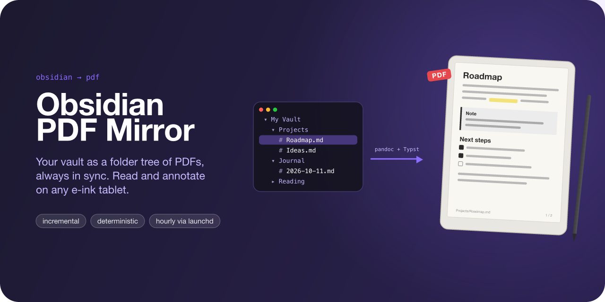
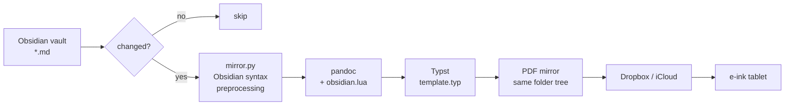

<p align="center">
  
</p>

<p align="center">
  <strong>Keep a PDF copy of every note in your Obsidian vault, in the same folder structure, always up to date.</strong>
</p>

<p align="center">
  
  
  
  
</p>

---

## Why

Obsidian is great for writing notes and less great for reading them on an e-ink tablet like a Supernote,
reMarkable or Boox. This tool mirrors the whole vault into a separate folder tree of nicely typeset PDFs,
for example inside Dropbox or iCloud Drive. Your tablet syncs that folder, so you always have every
note with you, with no manual exports.

It runs in the background via launchd (hourly by default) and only re-renders notes that actually changed.

## Features

- **Incremental.** A note is skipped when its mtime/size, content hash and embedded files (images,
  transcluded notes) are all unchanged. An idle run takes about 0.1 s.
- **Follows deletions and renames.** PDFs without a matching note are removed, and empty folders are pruned.
- **Deterministic output.** Re-rendering an unchanged note produces identical bytes, so the file is not
  rewritten and your sync client doesn't re-upload it.
- **Safe by default.** Does nothing if the vault is missing or empty, and never deletes more than 30% of
  the mirror in one run without `--force` (you get a macOS notification instead).
- **Unobtrusive.** Runs as a low-priority background job (efficiency cores, throttled I/O), one run at a time.
- **Self-updating.** Changing `mirror.py`, the Lua filter, the Typst template, the render settings or the
  installed pandoc/Typst version re-renders every note automatically on the next run.

## How it works



`mirror.py` scans the vault, compares each note against `.state/state.json`, and renders the ones that
changed in parallel: Obsidian-specific syntax is rewritten first, then pandoc (with a Lua filter) converts
the note to Typst, which produces the PDF. Each PDF gets the note's name as its title and the vault path
in the footer.

## Obsidian syntax support

| Rendered | Shown as code | Placeholder |
|---|---|---|
| Wikilinks (as text), image embeds `![[img.png\|300]]`, note/section/block embeds `![[Note#Heading]]`, callouts, `==highlights==`, `%%comments%%` (hidden), tasks, tables, math, footnotes | Dataview / Tasks queries, Mermaid diagrams | PDF and other attachment embeds, external images |

Frontmatter is stripped. Hidden folders (`.obsidian`, `.trash`, …) are always skipped.

## Requirements

- macOS (uses launchd and macOS notifications)
- [Homebrew](https://brew.sh). `install.sh` installs [pandoc](https://pandoc.org),
  [Typst](https://typst.app) and [uv](https://docs.astral.sh/uv/) if they are missing.

The default fonts (Helvetica Neue, Menlo, Apple Color Emoji) ship with macOS.

## Quick start

```sh
git clone https://github.com/schaefer-dev/obsidian_pdf_mirror.git
cd obsidian_pdf_mirror
$EDITOR config.toml   # set vault, output and excludes (the committed file is the author's setup)
./install.sh
```

`install.sh` is idempotent. It installs the dependencies, registers the launchd agent and links the
`obsidian-sync` command into `~/.local/bin`. The first sync starts immediately (about 30 s for 900 notes).

## Configuration

All settings live in [`config.toml`](config.toml):

| Key | Default | Description |
|---|---|---|
| `vault` | (required) | Path to the Obsidian vault |
| `output` | (required) | Folder that receives the PDF tree (must not be inside the vault, or vice versa) |
| `exclude` | `[]` | Glob patterns matched against vault-relative paths and file/folder names |
| `jobs` | `4` | Parallel renders |
| `paper` | `"a4"` | Typst paper size, e.g. `"a5"` or `"us-letter"` |
| `font` | `"Helvetica Neue"` | Body font |
| `codefont` | `"Menlo"` | Font for code |
| `lang` | `"de"` | Document language (hyphenation, quotes) |

Changing `paper`, `font`, `codefont` or `lang` re-renders every note on the next run.

## Usage

```sh
obsidian-sync                                # sync now
obsidian-sync --dry-run                      # show what would change
obsidian-sync -v                             # sync now, list each file
obsidian-sync --full                         # re-render everything
obsidian-sync --only "Projects/Roadmap.md"   # render a single note (repeatable)
obsidian-sync --force                        # allow a large deletion
```

**Change the interval:** to run every 30 minutes instead of hourly, use `INTERVAL=1800 ./install.sh`.
Missed runs during sleep are coalesced into one run on wake.

**Uninstall:** `./uninstall.sh` removes the launchd agent and the `obsidian-sync` command. It leaves the
PDFs, the state and the Homebrew packages in place.

## Troubleshooting

- **Logs.** Everything goes to `.state/mirror.log` in the project folder.
- **"Obsidian PDF mirror paused" notification.** A run would have deleted more than 30% of the mirror,
  which usually means the vault path is wrong or the vault isn't fully synced. Check `obsidian-sync --dry-run`,
  then run `obsidian-sync --force` if the deletion is intended.
- **A note failed to render.** The error is in the log. The note is retried when it changes, or with `--full`.
- **Trigger the background job manually:**
  `launchctl kickstart -k gui/$(id -u)/local.obsidian-pdf-mirror`

## Project layout

| Path | Purpose |
|---|---|
| `mirror.py` | Scan, change detection, Obsidian-syntax preprocessing, rendering, deletions |
| `render/obsidian.lua` | pandoc filter: callouts, embeds, tasks, images, links |
| `render/template.typ` | pandoc Typst template: page layout, fonts, callout styles |
| `config.toml` | Vault/output paths, excludes and render settings |
| `bin/obsidian-sync` | On-demand sync command (symlinked by `install.sh`) |
| `install.sh`, `uninstall.sh`, `Brewfile` | Setup and teardown |
| `launchd/mirror.plist.template` | launchd agent, filled in by `install.sh` |
| `assets/hero.typ` | Source of the banner above (`typst compile --format png --ppi 144 assets/hero.typ assets/hero.png`) |
| `.state/` | `state.json`, `mirror.log` (gitignored, machine-local) |

Everything, including state, lives inside the project folder, so you can move it to another Mac and re-run
`./install.sh`.

## License

[MIT](LICENSE)
